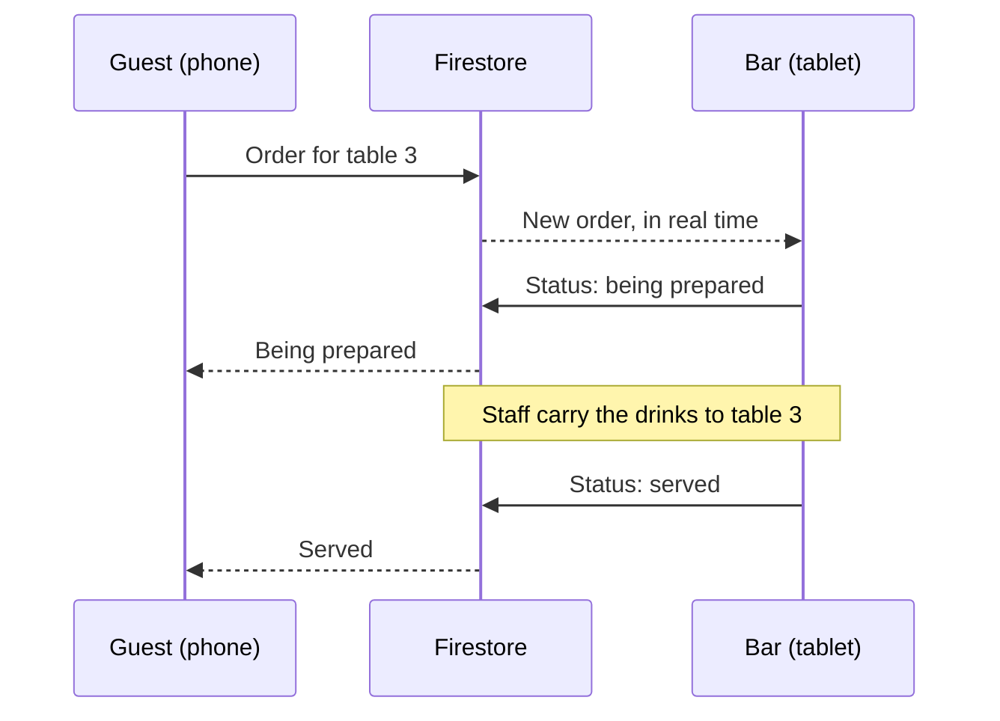

KiwiComp’s MacBook Pro, Connected
Finding a way to extract markdown from document tabs.
Jag tar fram riktiga markdown-filer ur flikarna och lägger dem i samma mappstruktur som i repot.

Created 6 files, shared 9 files, and 7 more steps
Alla åtta filer finns nu som riktiga markdown-filer. Packa upp wedding-drinks-docs.zip i roten av repot, så hamnar de på rätt ställen:

AGENTS.md
CLAUDE.md
docs/conventions.md
docs/data-model.md
docs/roadmap.md
docs/strings.md
.claude/skills/pull-request/SKILL.md
.claude/skills/next-step/SKILL.md
Jag har rättat tre saker jämfört med flikarna:

Skillarna börjar med ---, så att Claude Code kan läsa frontmattern. Kodblocken runt frontmattern är borta.
Relativa länkar mellan filerna är tillbaka, till exempel från AGENTS.md till docs/conventions.md.
Status i roadmapen står som text, eftersom en rullista inte finns i markdown. En rad förklarar de tre möjliga värdena.
Koden i data-model.md och strings.md är hämtad direkt ur filerna jag har typkontrollerat och testat, inklusive ändringarna om att drinkarna serveras vid bordet.

När filerna ligger i repot bör repot vara det som gäller. Dokumentet i Claude kan du använda för diskussion och planering, men ändringar i reglerna gör du i filerna, så att agenten alltid läser den senaste versionen.


Wedding drinks docs
ZIP 

Agents
Document·MD 

Claude
Document·MD 

Conventions
Document·MD 

Data model
Document·MD 

Strings
Document·MD 

Roadmap
Document·MD 
Save skill
/pull-request
Commit the current changes, push the branch and open a pull request on GitHub. Use when the developer asks to create a pull request.

The skill’s settings, as they will be saved:
name: pull-request
description: Commit the current changes, push the branch and open a pull request on GitHub. Use when the developer asks to create a pull request.
disable-model-invocation: true
Save skill
/next-step
Find the next step in docs/roadmap.md, create its branch and propose a plan for it. Use when the developer asks to start the next step.

The skill’s settings, as they will be saved:
name: next-step
description: Find the next step in docs/roadmap.md, create its branch and propose a plan for it. Use when the developer asks to start the next step.
disable-model-invocation: true
Du behöver också skapa en README.md som jag kan använda när jag skapar upp github repot

Created a file, shared 2 files, ran 3 commands
README.md är klar, och zip-filen innehåller nu alla nio filerna. README:n innehåller:

vad appen gör, med betoning på att personalen bär ut drinkarna till borden
en statusrad som länkar till roadmapen
bakgrunden om bröllopet och varför appen byggs om
hur appen fungerar, med ett sekvensdiagram i Mermaid som GitHub visar direkt
stack, kom igång-instruktioner och dokumenten i repot
ett kort avsnitt om hur du arbetar med Claude Code
Det här behöver du tänka på:

Välj MIT under “Add license” när du skapar repot på GitHub. README:n länkar till LICENSE. Du kan ladda upp README:n direkt i stället för att låta GitHub skapa en.
Repots namn är wedding-drinks i README:n. Byter du namn behöver du ändra raden med git clone.
Kom igång-avsnittet beskriver hur det blir. Kommandona fungerar först efter fas 0 och 1. Det står i README:n, och steg 1.1 behöver se till att .env.development innehåller demovärden för emulatorerna.
Avsnittet om AI-agenten är skrivet i jag-form utifrån hur CLAUDE.md beskriver arbetet. Justera det om det inte stämmer med hur du faktiskt jobbar.
README:n innehåller inga siffror från kvällen. Om du vet ungefär hur många gäster och beställningar det var gör de bakgrunden starkare. Steg 4.5 i roadmapen skriver om README:n med demo och GIF när appen är klar.

Readme
Document·MD 

Wedding drinks docs
ZIP 


Readme · MD
# Wedding Drinks
 
Order from the table, served at the table. Wedding guests order drinks from their phones, the bar sees every order in real time, and staff carry the drinks out, so nobody has to leave their seat during the speeches.
 
> **Status:** being rebuilt step by step. Progress is tracked in [docs/roadmap.md](docs/roadmap.md).
 
## Background
 
The first version was built in one week for a wedding in the summer of 2026. Each table had its own QR code, guests ordered from their phones, and staff brought the drinks to the tables. It did its job, but it was built fast: no sign-in, open database rules and no tests.
 
This repo rebuilds the app around the same idea, on a proper foundation: TypeScript, real-time data validated with Zod, security rules with tests, and a UI in English and Swedish.
 
## How it works
 
- **Guest view** (`/table/:tableId`): a mobile page reached through the table's QR code. Guests browse the menu, send an order and follow its status. They are signed in anonymously in the background.
- **Bar view** (`/bar`): a tablet page for staff. It shows active orders by table, oldest first, and lets staff move each order forward and mark drinks as sold out.

 
## Tech stack
 
| Area | Choice |
| --- | --- |
| App | React 19 with React Compiler, TypeScript, Vite, React Router |
| Backend | Firebase: Firestore, Auth, Hosting and the Emulator Suite |
| Data | Real-time subscriptions with `onSnapshot`, validated with Zod |
| UI | Tailwind CSS and shadcn/ui, English and Swedish |
| Tests | Vitest, React Testing Library, Firestore rules tests and Playwright |
| CI | GitHub Actions |
 
## Getting started
 
You need Node.js 22 or later, and Java 21 or later for the Firebase emulators. No Firebase account is needed: `.env.development` points the app at the emulators with a demo project.
 
```bash
git clone https://github.com/KiwiComp/wedding-drinks.git
cd wedding-drinks
npm install
npm run emulators   # terminal 1: Firestore and Auth emulators
npm run seed        # terminal 2: the menu, 8 tables and a staff account
npm run dev
```
 
Then open `http://localhost:5173/table/3` as a guest and `http://localhost:5173/bar` as staff. The seeded staff account is `bar@demo.test` with the password `demo-bar-1234`.
 
These commands arrive with the first two phases of the roadmap. All scripts are listed in [AGENTS.md](AGENTS.md).
 
## Project documents
 
| Document | Content |
| --- | --- |
| [AGENTS.md](AGENTS.md) | The project, its commands, structure and data model |
| [docs/conventions.md](docs/conventions.md) | The rules for code, data, security, strings, tests and Git |
| [docs/data-model.md](docs/data-model.md) | The Firestore data, the Firebase layer, the security rules and the seed data |
| [docs/strings.md](docs/strings.md) | Every UI string in English and Swedish |
| [docs/roadmap.md](docs/roadmap.md) | The steps to build the app, one pull request each |
| [CLAUDE.md](CLAUDE.md) | How Claude Code works in this repo |
 
## Working with an AI agent
 
I build this project with Claude Code as a pair programmer. The agent follows the rules in AGENTS.md and `docs/conventions.md`, and works through the roadmap one step at a time. It proposes a plan for each step before writing any code, and I review and approve every plan and every pull request.
 
## License
 
[MIT](LICENSE)
 
Claude finished the response
